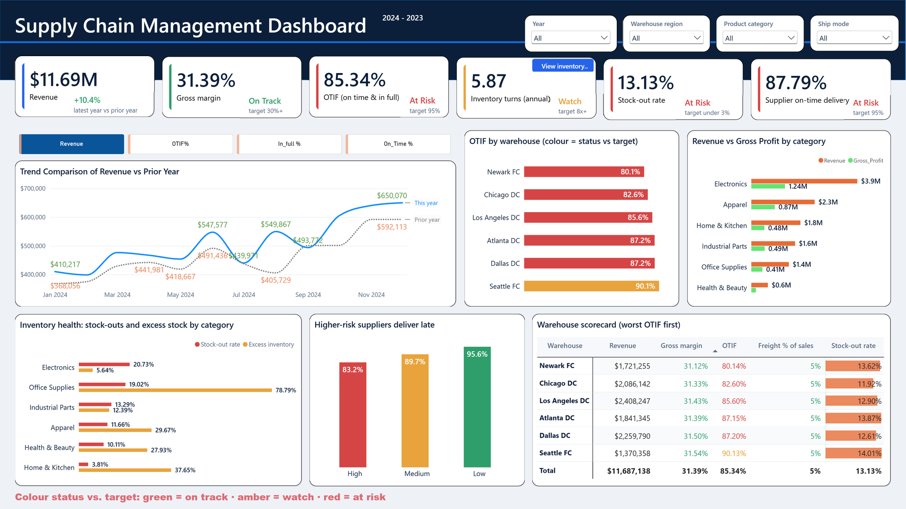
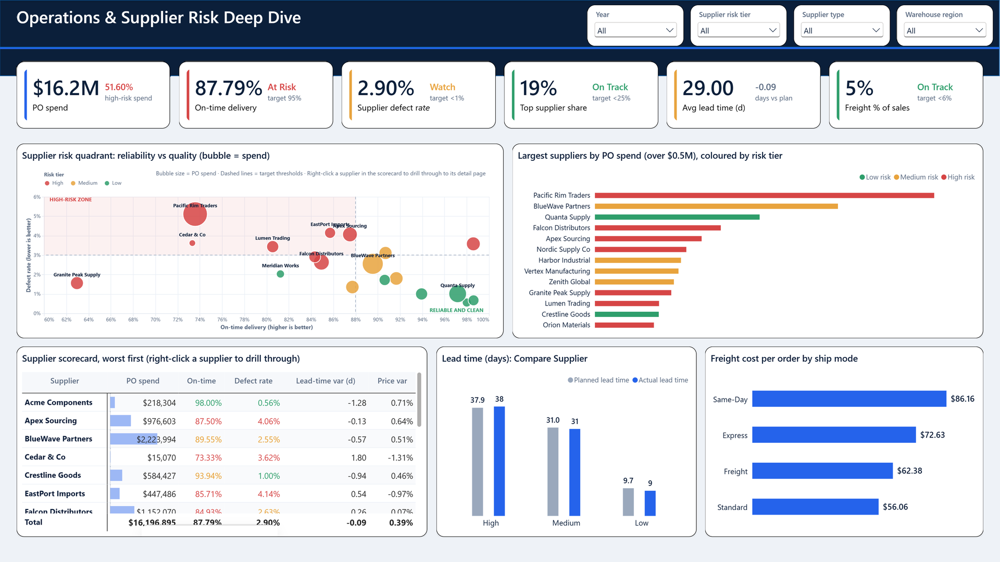
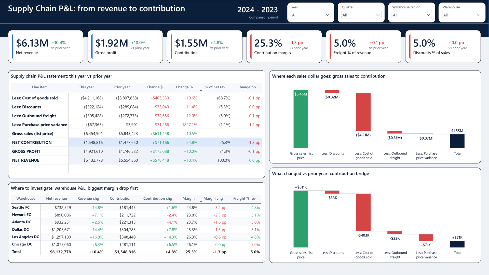
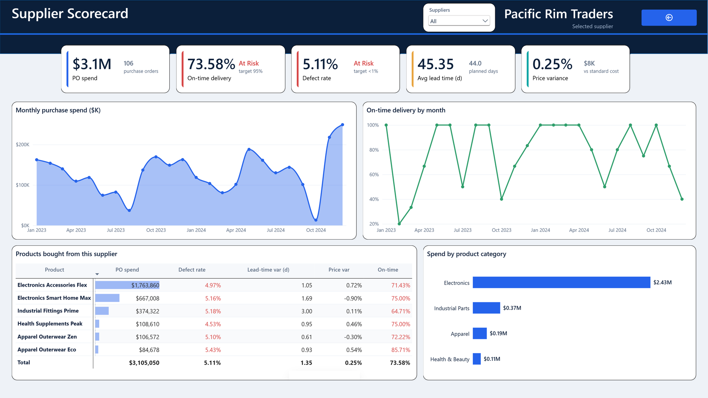
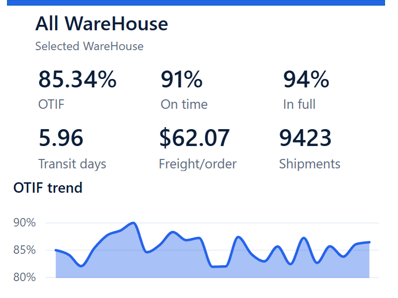
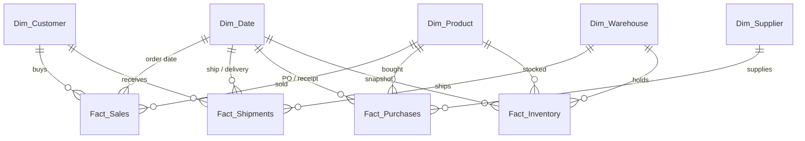

<div align="center">

# 📦 Supply Chain Control Tower

### An end-to-end Power BI dashboard that follows a product from **supplier → warehouse → customer → P&L**


-E8A33D)


</div>



---

## Table of contents
1. [Overview](#overview)
2. [Headline results](#headline-results)
3. [Report pages](#report-pages)
4. [Data model](#data-model)
5. [DAX highlights](#dax-highlights)
6. [Design decisions](#design-decisions)
7. [Repository structure](#repository-structure)
8. [Getting started](#getting-started)
9. [Known limitations](#known-limitations)
10. [About the author](#about-the-author)

---

## Overview

Supply chain leaders usually look at *service* (are orders on time?), *inventory* (is cash tied up?), *suppliers* (who can we rely on?) and *profit* (what does it all cost?) in separate reports. This project puts them in **one connected model**, so a question like *"why did margin move?"* can be traced back to a late supplier, an overstocked warehouse or a missed delivery.

| Stage | Question answered | Source tables |
|---|---|---|
| Procure | Which suppliers are reliable, and how much spend sits with risky ones? | `Fact_Purchases`, `Dim_Supplier` |
| Store | Where is cash tied up, and where are we running out? | `Fact_Inventory`, `Dim_Warehouse` |
| Deliver | Are orders on time **and** in full? | `Fact_Shipments` |
| Sell | What did we sell and at what margin? | `Fact_Sales`, `Dim_Product`, `Dim_Customer` |
| Profit | What is the supply-chain-adjusted contribution? | all of the above, rolled into a P&L |

> The dataset is **synthetic** (a public supply-chain practice dataset). The numbers demonstrate the analysis, not a real company.

## Headline results

| KPI | Value | KPI | Value |
|---|---|---|---|
| Revenue | **$11.69M** | OTIF | **85.34%** (8,042 of 9,423 shipments) |
| Gross margin | **31.39%** | On-time / In-full | 90.68% / 94.20% |
| Inventory turns | **5.87×** | Stock-out rate | 13.13% |
| Excess stock | 31.4% | Supplier on-time delivery | 87.79% |
| Defect rate | 2.90% | PO spend | $16.2M (**51.6% with high-risk suppliers**) |
| Net contribution 2024 | **$1.55M** (+4.8% YoY) | Contribution margin | 25.3% vs 26.6% prior year |

These figures were reconciled against the source CSVs.

## Report pages

### 1 · Executive Control Tower
One-screen health check: revenue, margin, OTIF, turns and stock-out KPIs with year-over-year deltas, a **field-parameter trend chart** (switch the metric without adding a visual), service by warehouse, and a **bookmark toggle** that swaps the OTIF chart for an inventory-by-category combo chart in the same space.


### 2 · Operations & Supplier Risk
Where service is lost and which suppliers carry the risk. The **supplier risk quadrant is a Deneb (Vega-Lite) visual** plotting delivery performance against quality, with spend as bubble size and risk bands driven by a reference table (`Ref_Risk_Thresholds`) rather than hard-coded.



### 3 · Supply Chain P&L
Turns operational problems into money: net revenue to contribution, with a variance column against the prior year, built on a disconnected `PL Lines` table so one matrix drives the whole statement.



### 4 · Supplier Scorecard (drill-through)
Right-click a supplier on page 2 to land here: spend, on-time %, defect %, lead time and the products bought from them. Example shown: *Pacific Rim Traders*.



### 5 · Warehouse Snapshot (report-page tooltip)
Hover a warehouse to get a mini-dashboard (OTIF, on-time, in-full, transit days, freight per order and an OTIF trend) instead of a bare number.

<p align="center"></p>

## Data model

A **star schema**: four fact tables sharing five dimensions. Role-playing dates (order, ship, delivery, PO) use inactive relationships activated with `USERELATIONSHIP` inside the measures.



* 21 relationships (7 inactive / role-playing) and 146 measures in a dedicated `_Measures` table, organised in display folders.
* Disconnected helper tables: `Ref_Risk_Thresholds` (risk bands), `PL Lines` (statement layout) and the `CY_Dynamic Line` field parameter.

## DAX highlights

Patterns used across the model:

* Perfect-order rate (OTIF): a shipment counts only if it is **both** on time **and** in full.
* Time intelligence on role-playing dates via `USERELATIONSHIP`.
* Inventory turns, days of inventory (DIO), and excess / stock-out classification against thresholds.
* Supplier risk scoring and high-risk spend share.
* P&L variance using an `ABS` base, and status-series measures for conditional colours.
* A field parameter with a hidden order column.

## Design decisions

* **Three status-series measures instead of per-bar colour rules**: conditional colours on bars did not render reliably, so green / amber / red are separate series.
* **Measure filter instead of a TopN visual filter**: the TopN filter hung Power BI Desktop on this model.
* **Thresholds in a table, not in DAX**: business users can tune risk bands without touching code.
* **Tooltip and drill-through pages are hidden from navigation** and reachable only in context.
* **PBIP / PBIR format**: the report is plain text, so it can be diffed, reviewed and version-controlled like code.

## Repository structure

```
Supply_Chain_Dashboard/
├── SCM Dashbaord.pbip              # open this in Power BI Desktop
├── SCM Dashbaord.Report/           # report definition (PBIR): pages, visuals, bookmarks
├── SCM Dashbaord.SemanticModel/    # model definition (TMDL): tables, measures, relationships
├── Data/                           # source CSVs
└── docs/
    ├── images/                     # page screenshots used in this README
    └── ai-bundle/                  # generated documentation bundle (HTML, facts JSON, per-visual images)
```

## Getting started

1. Install the latest **Power BI Desktop** and enable *Options → Preview features → Power BI Project (.pbip) save option*.
2. Clone the repository:
   ```bash
   git clone https://github.com/kumar98rishav-oss/Supply_Chain_Dashboard.git
   ```
3. Open `SCM Dashbaord.pbip`.
4. Point the `path` parameter at your local copy of the data (*Transform data → Edit parameters*).

## Known limitations

Documented openly:

* **Data refresh:** the `path` parameter in the model points to the author's machine, and `Fact_Shipments`, `Fact_Purchases` and `Fact_Inventory` in `Data/` lack the flag columns the model expects (and use `m/d/yyyy` dates). The model will not refresh from `Data/` as-is. Use the screenshots and documentation bundle to review the report.
* **Documentation bundle verification:** the bundle's self-check reports one failure (`consistency:OTIF`). It is a name-collision false alarm between two measures called OTIF, not a wrong figure; the value was reconciled by hand (8,042 / 9,423 = 85.34%).
* **Screenshots** are composed from the bundle's per-visual captures at their exact report positions, with a few stray hover-popup pixels retouched.
* **P&L matrix** is currently sorted by "% of net revenue", and `PL Var %` has no sign-flip guard, so a line whose prior-year value is near zero (for example purchase-price variance) shows an extreme percentage.
* **Forecasting** was deliberately left out in favour of the P&L page.

## About the author

**Rishav Kumar**: Power BI Developer / Data Analyst focused on supply chain, pharma and operations analytics.

[](https://github.com/kumar98rishav-oss)

If this project is useful, a ⭐ is appreciated.
